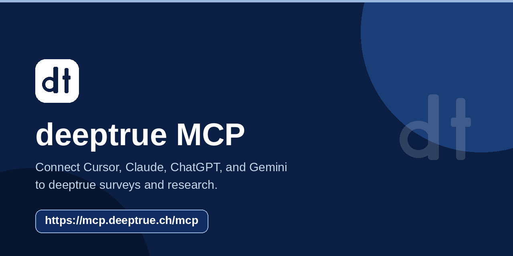
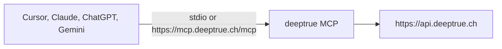

# deeptrue MCP

Connect **Cursor**, **Claude**, **ChatGPT**, and **Gemini** to [deeptrue](https://www.deeptrue.ch) surveys and research. This Model Context Protocol server reads and updates projects, briefings, surveys, fielding, panels, and reports through `https://api.deeptrue.ch`.




## Connect in one step

Create a key under **Settings → MCP API keys** on [app.deeptrue.ch](https://app.deeptrue.ch/settings/mcp-api-keys). The secret starts with `dt_` and is shown once. Node.js 20.9 or newer is required for the local command.

Paste this into the client’s MCP config (Cursor’s project or user `mcp.json`, or the same shape in Claude). Replace `dt_replace_me`. The same file is [`mcp.example.json`](./mcp.example.json).

```json
{
  "mcpServers": {
    "deeptrue": {
      "command": "npx",
      "args": ["-y", "github:deeptrue-ag/deeptrue-mcp"],
      "env": {
        "DEEPTRUE_API_BASE": "https://api.deeptrue.ch",
        "DEEPTRUE_API_KEY": "dt_replace_me"
      }
    },
    "deeptrue-remote": {
      "url": "https://mcp.deeptrue.ch/mcp"
    }
  }
}
```

Use `deeptrue` when the client starts a local process. Use `deeptrue-remote` when it asks for a URL. You only need one of them. `DEEPTRUE_API_KEY` is the only value you must set. `DEEPTRUE_API_BASE` is optional and already points at `https://api.deeptrue.ch`.

Keep the key in that local file or a password manager. Do not commit it.

## Clients

| Client | Connection | Credentials |
| --- | --- | --- |
| Cursor | Local command `npx -y github:deeptrue-ag/deeptrue-mcp` | `DEEPTRUE_API_KEY` |
| Claude | Local command, or remote `https://mcp.deeptrue.ch/mcp` | API key locally. OAuth on the remote URL, or an API key if Claude asks for one |
| ChatGPT | Remote `https://mcp.deeptrue.ch/mcp` | OAuth only. Do not paste a `dt_…` key |
| Gemini | Local command if Gemini runs a process, or the remote URL | API key, or a bearer this server exchanges for a session. No separate Gemini API |

## Cursor

Add the `deeptrue` block to Cursor’s MCP settings. Cursor starts the process and passes `DEEPTRUE_API_KEY`. With no arguments the command speaks MCP over stdio.

## Claude

- **Desktop or Claude Code:** the `deeptrue` block. Desktop reads `claude_desktop_config.json`. Claude Code reads a project MCP file with the same `mcpServers` shape.
- **Remote:** add a connector with URL `https://mcp.deeptrue.ch/mcp`. Sign in with deeptrue OAuth, or provide a `dt_…` key if that Claude client asks for a header.

## ChatGPT

Add a remote connector with URL `https://mcp.deeptrue.ch/mcp` and complete OAuth. ChatGPT remote connectors must use OAuth. Do not put a `dt_…` API key in the ChatGPT connector settings.

## Gemini

This server has no Gemini-only connector or endpoint. If the Gemini client runs a local MCP server, use the `deeptrue` block and `DEEPTRUE_API_KEY`. If it connects to a remote MCP server, use `https://mcp.deeptrue.ch/mcp`.

A `dt_…` key is sent as an API key. Any other bearer token is sent as an OAuth access token. Both are exchanged for a session JWT before survey and project calls. You do not configure that session JWT yourself. Details are in [Authentication](#authentication).

## Authentication

Local clients send `DEEPTRUE_API_KEY`. Remote clients send either of these headers:

| Header | Value |
| --- | --- |
| `X-DeepTrue-Api-Key` | `dt_…` key |
| `Authorization` | `Bearer dt_…` for an API key, or `Bearer` plus an OAuth access token |

The server posts that credential to `POST https://api.deeptrue.ch/v1/auth/mcp/session/` (`api_key` or `access_token`) and uses the session JWT from the response for later API calls. If the API returns 401, the server exchanges a new session once and retries the call. Revoking the API key makes the next exchange fail.

People who already have a dashboard session can also create a key:

```bash
curl -X POST https://api.deeptrue.ch/v1/auth/mcp/keys/ \
  -H "Authorization: JWT <your-jwt>" \
  -H "Content-Type: application/json" \
  -d '{"name":"cursor"}'
```

`GET https://mcp.deeptrue.ch/healthz` returns `{ "ok": true, "service": "deeptrue-mcp" }`.

## Environment variables

| Variable | Required | Purpose |
| --- | --- | --- |
| `DEEPTRUE_API_KEY` | Local stdio | `dt_…` key from **Settings → MCP API keys** |
| `DEEPTRUE_API_BASE` | No | API origin. Default `https://api.deeptrue.ch` |
| `DEEPTRUE_ORG` | No | Organization domain or slug. Omit it to use the organization stored on the key |

Pass `organization` on a tool, send `X-DeepTrue-Org` on HTTP, or set `DEEPTRUE_ORG` for a local process. The choice applies to that request. `set_active_organization` checks that the organization is usable; it does not stick for later remote calls.

## Tools

A usual project path is `create_project` → `submit_briefing_answers` → `accept_project` → `start_fielding` → `finish_fielding`. Tools that change data require `confirm=true` and a write scope (`mcp:write`, or a narrower scope such as `mcp:projects`, `mcp:surveys`, `mcp:fielding`, or `mcp:reports`).

### Organizations

| Tool | What it does |
| --- | --- |
| `list_organizations` | Organizations available to the signed-in user |
| `get_organization` | Address and info for one organization domain or slug |
| `set_active_organization` | Check that the user can use an organization. Does not persist on stateless HTTP |

### Projects

| Tool | What it does |
| --- | --- |
| `list_projects` | Projects in the active organization |
| `get_project` | One project by numeric id |
| `create_project` | Create a project. Requires a write scope |
| `update_project` | Patch project fields such as name or json. Requires `confirm=true` |
| `get_briefing` | Read flattened briefing answers |
| `submit_briefing_answers` | Write briefing answers onto the project. Requires `confirm=true` |
| `accept_project` | Accept an offer and spawn the survey. Requires `confirm=true` |
| `start_fielding` | Start collection for an accepted project. Requires `confirm=true` |
| `finish_fielding` | Finish a project that is collecting. Requires `confirm=true` |
| `archive_project` | Archive a project. Requires `confirm=true` |
| `restore_project` | Restore an archived project. Requires `confirm=true` |

### Surveys

| Tool | What it does |
| --- | --- |
| `list_surveys` | Surveys in the active organization |
| `get_survey` | One survey by uuid |
| `update_survey_structure` | Patch only `name`, `json`, `survey_template_uuid`, and `id`. Requires `confirm=true` |
| `get_survey_statistics` | Statistics for a project uuid |
| `list_respondents` | Status, timing, quota, and furthest question. Personal data stays redacted unless `include_pii=true` and the token has `mcp:pii` (`mcp:write` does not grant it) |

### Panels

These calls use deeptrue admin routes. A non-admin gets 403, and the tool reports that refusal.

| Tool | What it does |
| --- | --- |
| `get_feasibility` | Status snapshot for Cint, Dynata, or Bilendi |
| `list_panel_projects` | Cint demands or audit, Bilendi projects or audit, or Dynata projects or audit |

### Reports

| Tool | What it does |
| --- | --- |
| `list_reports` | Report files for the organization. Members can call this |
| `get_report` | One report file by id. Members can call this |
| `get_report_layouts` | Layouts for audience `org` (default) or `admin` |
| `trigger_report_refresh` | Save a report HTML snapshot. deeptrue admins only. Requires `confirm=true`. A 403 means nothing was saved |

## Architecture

Local clients start this server with `npx`. Remote clients open `https://mcp.deeptrue.ch/mcp`. Every tool calls `https://api.deeptrue.ch`.



## Safety

Prefer `get_project` or `get_survey` before an edit. `update_survey_structure` rejects any field other than `name`, `json`, `survey_template_uuid`, and `id`. Respondent personal data needs both `include_pii=true` and the `mcp:pii` scope.

## Develop

```bash
git clone https://github.com/deeptrue-ag/deeptrue-mcp.git
cd deeptrue-mcp
npm install
npm test
```

`npm install` compiles TypeScript. `npx deeptrue-mcp` with no arguments speaks MCP over stdio and reads `DEEPTRUE_API_KEY` from the environment. Node.js 20.9 or newer.

## License

[MIT](./LICENSE) © deeptrue AG
